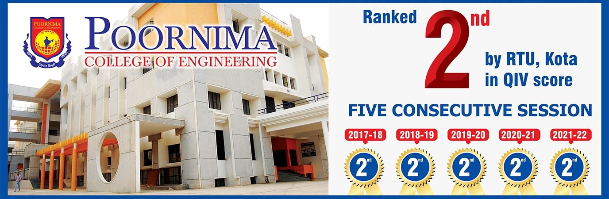

<!-- =========================================================
     DIVYANSH KUMAR | GITHUB PROFILE README
     Design: Professional headings + animated space visuals
========================================================== -->

<h1>Hi 👋, I'm Divyansh Kumar</h1>

<h3>Computer Science Student • Software Development • AI & Data Science Enthusiast</h3>

 

  

---

## 👨‍💻 About Me

I'm a **Computer Science and Engineering undergraduate at Poornima College of Engineering, Jaipur**, passionate about software development, problem-solving and practical engineering projects.

I enjoy learning how applications work, connecting software with databases, and building projects that solve real-world problems.

- 🎓 **Education:** B.Tech in Computer Science & Engineering
- 💻 **Programming:** Java, Python, C, C++ and JavaScript
- 🌐 **Web:** HTML, CSS and JavaScript
- ⚙️ **Backend & Database:** Flask, JDBC and MySQL
- 📡 **Technical Exposure:** Industrial IoT training through CSIR-CEERI
- 🏆 **Recognition:** Second position in AADHAR'25 Open Innovation
- 📜 **Innovation:** Contributor to a smart waste-monitoring patent application
- 🎯 **Career Goal:** Strengthen software engineering skills and prepare for internships

---

## 🏆 Achievements

  

  

  

  

### Achievement details

- **AADHAR'25 Tech Fest:** Second position in Open Innovation at Poornima College of Engineering.
- **Patent contribution:** *Waste Monitoring Through Smart Detection System*, Indian patent application `202611002943`.
- **Smart India Hackathon 2024:** Selected in the institutional internal selection process.
- **NPTEL Elite:** Enhancing Soft Skills & Personality, IIT Kanpur, with a score of 67%.
- **CSIR-CEERI:** Advance Industrial Internet of Things (IIoT) training, Jaipur Campus.

> SIH refers to institutional selection, not a national-level win. Patent contribution does not imply that the patent has been granted.

---

## 🔭 Currently Building

- Improving Java programming and database application development.
- Building and refining practical software projects.
- Strengthening backend development fundamentals.
- Exploring full-stack application development.
- Applying engineering concepts to useful project ideas.

## 🌱 Currently Learning

- Data Structures & Algorithms
- Advanced Java programming
- SQL and database design
- Backend application development
- REST API fundamentals
- Full-stack development fundamentals
- AI and Machine Learning fundamentals
- Git and collaborative development workflows

---

## ⚡ Technical Strengths

| Area | Technologies & Concepts |
|:---|:---|
| Programming | Java, Python, C, C++, JavaScript |
| Web Development | HTML, CSS, JavaScript |
| Backend | Python, Flask, JDBC |
| Databases | MySQL, SQL, CRUD operations |
| Software Engineering | OOP, debugging, code organization |
| Version Control | Git, GitHub |
| Engineering Exposure | Industrial IoT, sensors, automation concepts |
| Current Learning | DSA, backend development, AI fundamentals |

---

## 🛠️ Tech Stack

### 💻 Programming Languages

### 🌐 Frontend Development

- HTML5 and CSS3
- JavaScript fundamentals
- Browser-based interfaces
- Responsive UI concepts

### ⚙️ Backend Development

- Python
- Flask
- JDBC-based Java applications
- REST API fundamentals — learning
- Backend application fundamentals

### 🤖 Artificial Intelligence & Data Science

**Areas of interest and learning**

- Artificial Intelligence fundamentals
- Machine Learning fundamentals
- Data cleaning and preprocessing
- Exploratory Data Analysis (EDA)
- Data visualization
- Generative AI and prompt engineering
- Responsible AI and AI ethics

**Libraries to practice and explore**

`Pandas` · `NumPy` · `Matplotlib` · `scikit-learn`

### 🗄️ Databases

- SQL and MySQL
- Java Database Connectivity (JDBC)
- CRUD operations
- DAO design pattern
- PreparedStatement
- Relational database fundamentals

### ☁️ Cloud & DevOps

*Future learning roadmap*

- Cloud computing fundamentals
- AWS and Microsoft Azure fundamentals
- GitHub Actions and CI/CD
- Docker and Kubernetes
- Vercel deployment
- Firebase — future exploration

### 🛠️ Tools

- Git and GitHub
- Visual Studio Code
- IntelliJ IDEA
- MySQL Workbench
- Python development environments

<b>View additional technical learning areas</b>

**Frontend roadmap**
- React.js
- TypeScript
- Next.js
- Tailwind CSS

**Backend roadmap**
- Node.js and Express.js
- Django
- Authentication fundamentals
- REST API development

**Database exploration**
- PostgreSQL
- MongoDB
- Supabase

**AI/ML roadmap**
- Supervised learning
- Model evaluation
- Feature engineering
- TensorFlow and PyTorch fundamentals
- OpenCV basics

**Cloud and security roadmap**
- Identity and Access Management
- Secure coding fundamentals
- Privacy and responsible AI
- Governance, Risk & Compliance concepts

These are learning or exploration areas, not claims of professional expertise.

---

## 💼 Engineering Expertise

### 💻 Software Engineering

- Object-Oriented Programming (OOP)
- Programming fundamentals and problem-solving
- Data Structures & Algorithms — actively learning
- Software Development Life Cycle (SDLC)
- Database design fundamentals
- Version control using Git and GitHub
- Debugging and code organization
- REST API fundamentals — learning

### 🌐 Full-Stack Development

<table>
<tr>
<td width="33%" valign="top">

<h3 align="center">Frontend</h3>

- HTML
- CSS
- JavaScript
- Responsive UI concepts

</td>
<td width="33%" valign="top">

<h3 align="center">Backend</h3>

- Python
- Flask
- JDBC
- REST API fundamentals

</td>
<td width="33%" valign="top">

<h3 align="center">Database</h3>

- MySQL
- SQL
- CRUD operations
- DAO pattern

</td>
</tr>
</table>

### 🤖 AI & Data Science

- Artificial Intelligence fundamentals
- Machine Learning — learning
- Data analysis and visualization
- Generative AI exploration
- Prompt engineering
- Responsible AI concepts

### ☁️ Cloud & Security

- Cloud computing fundamentals — learning roadmap
- AWS and Microsoft Azure — future learning
- CI/CD and deployment — future learning
- Identity and access management concepts
- Secure coding and privacy fundamentals

---

## 🚀 Featured Projects

<table>
<tr>
<td width="50%" valign="top">

<h3>🌊 Seismic Insight</h3>

A web-based educational project focused on seismic-wave and earthquake simulation.

**Key features**
- Browser-based interface
- Seismic simulation focus
- Flask backend
- Web visualization
- Educational use case

**Tech stack:** Python, Flask, HTML, CSS, JavaScript

</td>
<td width="50%" valign="top">

<h3>🎓 Student Management System</h3>

A Java application for managing student records using database connectivity.

**Key features**
- Create, read, update and delete operations
- JDBC connectivity
- DAO design pattern
- PreparedStatement
- MySQL database integration

**Tech stack:** Java, JDBC, MySQL

</td>
</tr>
<tr>
<td width="50%" valign="top">

<h3>♻️ Smart Waste Monitoring System</h3>

A smart waste-monitoring project associated with my patent contribution.

**Project focus**
- Smart detection concept
- Problem analysis
- System design and documentation
- Innovation and practical problem-solving

**Patent application:** `202611002943`

</td>
<td width="50%" valign="top">

<h3>📘 Value Added Course</h3>

A coursework repository containing material related to HTML and web fundamentals.

**Project focus**
- HTML practice
- Web development fundamentals
- Learning resources and coursework

</td>
</tr>
</table>

---

## 📜 Professional Certifications

<table>
<tr>
<td width="50%" valign="top">

### 🎓 NPTEL — IIT Kanpur

**Enhancing Soft Skills & Personality**

- Issuer: IIT Kanpur
- Ministry of Education, Government of India
- February–April 2026

</td>
<td width="50%" valign="top">

### 🏭 CSIR-CEERI

**Advance Industrial Internet of Things Training**

- CSIR–Central Electronics Engineering Research Institute
- Jaipur Campus
- March–April 2026

</td>
</tr>
<tr>
<td width="50%" valign="top">

### 🐍 WUWB Technologies

**Python Programming Industrial Training**

- WUWB Technologies Pvt. Ltd., Jaipur
- June–July 2025

</td>
<td width="50%" valign="top">

### 📚 Additional Learning Resources

- Microsoft Learn
- Kaggle
- LinkedIn Learning
- Google Cloud learning resources
- NPTEL
- W3Schools

*These are learning resources, not additional earned certifications.*

</td>
</tr>
</table>

---

## 🏅 Core Domains

**Current learning roadmap:** DSA, Machine Learning fundamentals, full-stack development, cloud computing and Generative AI.

---

## 📊 GitHub Analytics

### 📊 GitHub Stats

  

### 💻 Top Languages

  

### 🔥 Contribution Streak

---

## 📈 Contribution Graph

---

## 🏆 GitHub Trophies

---

## 🐍 Contribution Snake

---

## 💻 Competitive Programming

I'm actively strengthening my **Data Structures & Algorithms** fundamentals and problem-solving skills.

<table>
<tr>
<td width="50%" valign="top">

### Fundamentals

- Arrays and Strings
- Searching and Sorting
- Linked Lists
- Stacks and Queues
- Recursion and Backtracking

</td>
<td width="50%" valign="top">

### Further Learning

- Trees and Graphs
- Binary Search
- Sliding Window
- Greedy Algorithms
- Dynamic Programming

</td>
</tr>
</table>

**LeetCode:** Add your actual profile URL and verified solved count when available.

---

## 🎯 2026 Goals

- 🚀 Strengthen Java, DSA and core CS fundamentals.
- 📦 Build practical and well-documented software projects.
- 🌐 Improve backend and full-stack development skills.
- 🤝 Explore open-source contributions.
- 📈 Build consistent and meaningful GitHub activity.
- 🏆 Prepare for software engineering internships.
- 💡 Apply technology to practical problems.

---

## 🎓 Education

  
  
<b>Poornima College of Engineering, Jaipur</b>

### Poornima College of Engineering

**Bachelor of Technology — Computer Science & Engineering**

- 📍 Jaipur, Rajasthan, India
- 🎓 Expected graduation: May 2028
- 💻 Academic interests: Programming, databases, software development and AI

### Career Objective

To strengthen my software engineering fundamentals, contribute to practical projects, collaborate with developers and prepare for internship opportunities where I can learn and contribute to real-world applications.

---

## 🌍 Let's Connect

&nbsp;&nbsp;

&nbsp;&nbsp;

  

**Interested in software development, practical projects, innovation and collaboration.**

---

## 🤝 Open to Collaborate

I'm interested in learning and collaborating on projects related to:

- 💻 Software Engineering
- ⚙️ Backend Development
- 🌐 Full-Stack Development
- 🤖 AI and Machine Learning learning projects
- 📊 Data Science and Visualization
- 📡 IoT and Automation
- 🌍 Open Source
- 🏆 Hackathons and Innovation Challenges

---

## 📈 Current Focus

<table>
<tr>
<td width="33%" valign="top">

<h3 align="center">🛠️ Building</h3>

- Java applications
- Database projects
- Practical software solutions

</td>
<td width="33%" valign="top">

<h3 align="center">📚 Learning</h3>

- DSA
- Backend fundamentals
- Full-stack development

</td>
<td width="33%" valign="top">

<h3 align="center">🎯 Preparing</h3>

- Internship readiness
- Better project documentation
- Consistent coding practice

</td>
</tr>
</table>

---

## 💡 Fun Facts

- 🧠 I enjoy understanding how software works behind the scenes.
- 🔬 I like exploring practical engineering concepts.
- 🤖 I'm interested in AI-powered applications.
- 🛠️ I learn by building, testing and improving projects.
- 📚 I believe consistency matters more than simply collecting technologies.
- 🌱 I'm always open to learning something new.

---

## 📫 Contact Me

  

**Location:** Jaipur, Rajasthan, India

**Interested in:** Software engineering internships, backend development, full-stack learning, technical projects and open-source collaboration.

---

## 📊 Profile Summary

| Category | Details |
|:---|:---|
| Education | B.Tech CSE — Poornima College of Engineering |
| Programming | Java, Python, C, C++, JavaScript |
| Frontend | HTML, CSS, JavaScript |
| Backend | Flask, JDBC |
| Database | MySQL, SQL |
| Projects | Seismic Insight, Student Management System, Smart Waste Monitoring |
| Recognition | AADHAR'25 Open Innovation — Second Position |
| Training | CSIR-CEERI Industrial IoT, WUWB Python |
| Current Goal | Strengthen software engineering skills and prepare for internships |

---

### ⭐ Thanks for visiting my profile!

If you find my work interesting, explore my repositories and share your feedback.

Learning through code · Building through curiosity · Growing through consistency

